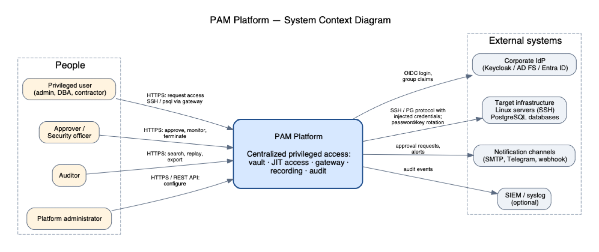
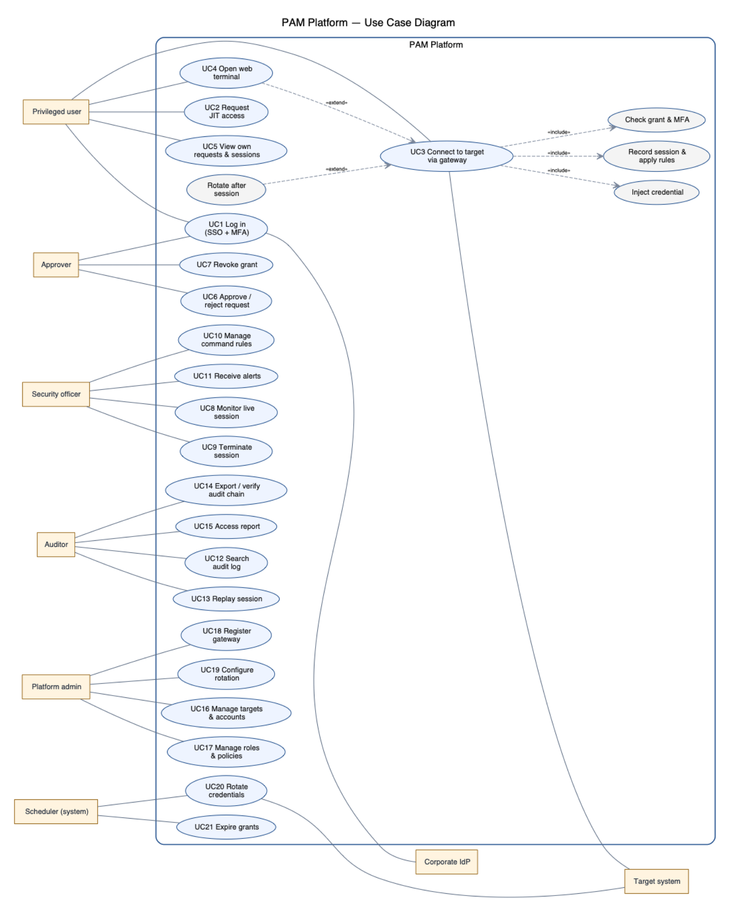
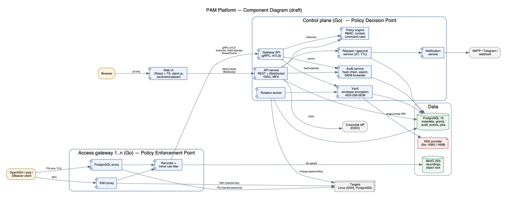

# 7. Architecture and Diagrams

Diagram sources (editable, Graphviz DOT) are in `diagrams/src/`; exports (SVG, PNG) in `diagrams/export/`. Regenerate with `make diagrams` (requires Graphviz).

## 7.1 Architectural style

PAM Platform follows the **zero-trust PDP/PEP pattern** of NIST SP 800-207 [5]:

- **Control plane = Policy Decision Point.** Decides whether a user may start a session (RBAC eligibility + active grant + MFA + context).
- **Access gateway = Policy Enforcement Point.** Every privileged connection passes through it (complete mediation [1]); it asks the control plane for a decision, gets the credential injected, records the session, applies command rules.
- **Vault** is a module of the control plane with its own key hierarchy; secrets leave it only towards a gateway over mTLS, never to a user.

## 7.2 System context diagram

| External actor / system | Interaction |
|---|---|
| Privileged user (admin, DBA, contractor) | Web UI (HTTPS) for requests; SSH/psql clients to gateway |
| Approver / security officer | Web UI: approve, monitor live, terminate |
| Auditor | Web UI: search, replay, export |
| Corporate IdP (Keycloak / AD FS / Entra ID) | OIDC login, group claims |
| Target infrastructure (Linux servers, PostgreSQL) | Gateway connects via SSH / PG protocol; rotation jobs change credentials |
| Notification channels (SMTP, Telegram, webhook) | Approval requests, alerts |
| SIEM / syslog | Audit event forwarding (could) |

## 7.3 Use case diagram

| Actor | Use cases |
|---|---|
| Privileged user | UC1 Log in (SSO + MFA) · UC2 Request JIT access · UC3 Connect to target via gateway · UC4 Open web terminal · UC5 View own requests/sessions |
| Approver | UC6 Approve / reject request · UC7 Revoke grant |
| Security officer | UC8 Monitor live session · UC9 Terminate session · UC10 Manage command rules · UC11 Receive alerts |
| Auditor | UC12 Search audit log · UC13 Replay session · UC14 Export / verify audit chain · UC15 Generate access report |
| Platform admin | UC16 Manage targets & accounts · UC17 Manage roles & policies · UC18 Register gateway · UC19 Configure rotation |
| Scheduler (system) | UC20 Rotate credentials · UC21 Expire grants |

`UC3` *includes* "Check grant & MFA" and "Inject credential"; "Record session" and "Apply command rules" are included in every session; "Rotate after session" *extends* UC3 when the account policy requires it.

## 7.4 Component diagram (draft)

| Component | Responsibility | Tech |
|---|---|---|
| **Web UI** | Request/approve, live view, replay, admin | React + TS, xterm.js, asciinema-player |
| **API service** (control plane) | REST API, OIDC validation, MFA, business logic | Go, `net/http`, OpenAPI |
| **Policy engine** | RBAC eligibility, grant validation, context conditions, command rules distribution | Go package `internal/policy` |
| **Request/approval service** | JIT workflow, TTL, auto-revocation | Go package `internal/access` |
| **Vault** | Envelope encryption, secret versions, check-out | Go package `internal/vault` |
| **Rotation worker** | Scheduled & post-session rotation via SSH / SQL | Go, job queue in PostgreSQL (`SKIP LOCKED`) |
| **Audit service** | Hash-chained append-only log, verifier, export, SIEM forwarder | Go package `internal/audit` |
| **Notification service** | E-mail, Telegram, webhook | Go |
| **Access gateway** (1..n) | SSH proxy, PostgreSQL proxy, recording, inline command rules, live streaming | Go, `x/crypto/ssh`, PG wire protocol |
| **PostgreSQL** | Metadata, grants, audit chain, job queue | PostgreSQL 16 |
| **Object storage** | Session recordings with object lock | MinIO |
| **IdP** (external) | Authentication | Keycloak (test bench) |

**Interfaces:** UI → API: REST/JSON + WebSocket (HTTPS). Gateway ↔ API: gRPC over mTLS (`Authorize`, `GetCredential`, `StreamEvents`, `UploadRecording`, `PushRules`). API/worker → PostgreSQL: SQL over TLS. Gateway → MinIO: S3 API.

## 7.5 Key scenario — SSH session via JIT grant (sequence, textual)

1. User logs in to UI via OIDC, submits request *(target `db-prod-01`, account `root`, 2 h, reason "INC-1042")*. → audit `request.created`.
2. Approver gets Telegram notification, approves in UI → grant `G` active 2 h. → audit `request.approved`, `grant.activated`.
3. User runs `ssh alice%root%db-prod-01@gw.corp`. Gateway authenticates Alice (short-lived user cert issued by API after MFA).
4. Gateway → API `Authorize(alice, root@db-prod-01)`: policy engine checks grant G, MFA age, time window → **allow** + session ID + command rules.
5. Gateway → API `GetCredential(session)` → vault decrypts secret, returns it over mTLS (held in gateway memory only).
6. Gateway opens SSH to target with vaulted key, bridges channels, records asciicast, streams to observers, evaluates each command line against rules.
7. Session ends (user exit / grant expiry / terminate). Gateway uploads recording to MinIO, sends `session.ended` with recording hash. If policy `rotate_after_use`, worker rotates the key.
8. Every step appends to the hash-chained audit log.

## 7.6 Data model (main entities)

`users`, `roles`, `role_bindings`, `targets`, `target_groups`, `accounts` (target + username + protocol + rotation policy), `secrets` (account_id, version, ciphertext, wrapped_dek, kek_id, created_at), `policies`, `access_requests`, `approvals`, `grants`, `sessions`, `recordings` (object key, sha256), `command_rules`, `rule_hits`, `audit_events` (seq, ts, actor, action, object, details JSONB, prev_hash, hash), `gateways`, `jobs`.

ER diagram: planned for pre-defense-2 (`diagrams/src/04-er.dot`).

## 7.7 Security of the platform itself (draft STRIDE highlights)

| Threat | Example | Mitigation |
|---|---|---|
| Spoofing | Fake gateway requests credentials | mTLS with certificates issued at registration; join tokens single-use |
| Tampering | Admin edits audit rows | Hash chain + external anchoring of head hash; DB role for API has INSERT only on `audit_events` |
| Repudiation | User denies running a command | Session recording bound to authenticated identity + hash in audit |
| Information disclosure | DB dump leaks secrets | Envelope encryption, KEK outside DB |
| Denial of service | Gateway overload | Per-user session limits, rate limiting |
| Elevation of privilege | Requester approves self | Separation-of-duties check in approval service |

## 7.8 Consistency check: requirements ↔ components ↔ scenarios

| Requirement group | Component(s) | Use case(s) |
|---|---|---|
| FR-U | API service, IdP | UC1 |
| FR-V | Vault, Rotation worker | UC19, UC20 |
| FR-A | Request/approval, Policy engine, Notification | UC2, UC6, UC7, UC21 |
| FR-G | Access gateway | UC3, UC4 |
| FR-M | Access gateway, Policy engine, Object storage, Web UI | UC8–UC11, UC13 |
| FR-AU | Audit service | UC12, UC14, UC15 |
| FR-AD | API service | UC16–UC18 |
